# CourseMaster Bug Report

_Bug bashing, fixes and verification for the CourseMaster frontend and backend. Prepared 19 November 2026._

## Summary

This report lists 37 bugs found in CourseMaster while bug-bashing the provided frontend and backend locally. All 37 are fixed and verified: 5 Critical, 10 High, 14 Medium and 8 Low. The most serious problems made the core flow unusable: nobody could log in (BUG-001, BUG-002), new students could not enroll (BUG-011) and the student dashboard crashed (BUG-014). Several security issues let users bypass route protection or read quiz answers (BUG-006, BUG-008).

Fixed code: frontend https://github.com/Ebratul/CourseMaster_frontend, backend https://github.com/Ebratul/CourseMaster_backend.

| ID | Title | Area | Severity | Priority | Status |
|---|---|---|---|---|---|
| BUG-001 | Login fails for every user with a correct password | Backend | Critical | P1 | Fixed & Verified |
| BUG-002 | User stays logged out after a successful login | Frontend | Critical | P1 | Fixed & Verified |
| BUG-003 | Authorization header is sent without the Bearer scheme | Frontend + Backend | High | P2 | Fixed & Verified |
| BUG-004 | Invalid or expired JWT is not rejected (500-style errors instead of 401) | Backend | High | P1 | Fixed & Verified |
| BUG-005 | Admin registration key is ignored | Backend | High | P2 | Fixed & Verified |
| BUG-006 | Client-side login bypass with hard-coded admin and student JWTs | Frontend | Critical | P1 | Fixed & Verified |
| BUG-007 | Banning a user has no effect | Backend | High | P2 | Fixed & Verified |
| BUG-008 | Quiz answers are exposed by the public course API | Backend + Frontend | Medium | P2 | Fixed & Verified |
| BUG-009 | Students can open the player for courses they are not enrolled in | Frontend | High | P2 | Fixed & Verified |
| BUG-010 | Any student can change another student's progress | Backend | High | P2 | Fixed & Verified |
| BUG-011 | Enrolling in any course fails with "Already enrolled in this course" | Backend | Critical | P1 | Fixed & Verified |
| BUG-012 | Lesson completion is saved without await | Backend | Medium | P2 | Fixed & Verified |
| BUG-013 | Quiz score is ten times too low | Backend | High | P2 | Fixed & Verified |
| BUG-014 | Student dashboard is a blank page | Frontend | Critical | P1 | Fixed & Verified |
| BUG-015 | Dashboard progress shows NaN% | Frontend | Medium | P2 | Fixed & Verified |
| BUG-016 | Course price is shown 100 times higher on the details page | Frontend | High | P2 | Fixed & Verified |
| BUG-017 | Selecting a batch breaks enrollment, and the first batch shows no confirmation | Frontend | Medium | P2 | Fixed & Verified |
| BUG-018 | Quiz lets you answer only one question at a time | Frontend | High | P2 | Fixed & Verified |
| BUG-019 | "Mark as Complete" never switches to "Completed" | Frontend | Medium | P3 | Fixed & Verified |
| BUG-020 | Course search fails on special characters | Backend + Frontend | Medium | P3 | Fixed & Verified |
| BUG-021 | Category and tag filters only match exact, case-sensitive values | Backend | Medium | P3 | Fixed & Verified |
| BUG-022 | Signed-in user is never loaded into app state on page load | Frontend | Medium | P3 | Fixed & Verified |
| BUG-023 | Admin overview "Top Courses by Enrollments" chart never appears | Frontend | Medium | P3 | Fixed & Verified |
| BUG-024 | Deleting a course or user leaves orphaned enrollments and submissions | Backend | Medium | P3 | Fixed & Verified |
| BUG-025 | Admin assignments ?courseId filter is ignored | Backend | Low | P3 | Fixed & Verified |
| BUG-026 | Validation errors give no details | Backend + Frontend | Medium | P3 | Fixed & Verified |
| BUG-027 | No server validation for grades, review status or course price | Backend | Medium | P3 | Fixed & Verified |
| BUG-028 | Invalid course id shows a raw database error | Backend | Low | P4 | Fixed & Verified |
| BUG-029 | Lesson video is a narrow 300×700 strip | Frontend | High | P2 | Fixed & Verified |
| BUG-030 | Mobile menu is cut off, so Logout and Dashboard can't be reached | Frontend | Medium | P3 | Fixed & Verified |
| BUG-031 | Every navbar link is highlighted as active | Frontend | Low | P4 | Fixed & Verified |
| BUG-032 | Long course titles overflow the course card | Frontend | Low | P3 | Fixed & Verified |
| BUG-033 | User emails are unreadable in dark mode | Frontend | Low | P3 | Fixed & Verified |
| BUG-034 | Profile link leads to an unstyled 404 | Frontend | Low | P4 | Fixed & Verified |
| BUG-035 | Course filters send a request on every keystroke and can show stale results | Frontend | Low | P3 | Fixed & Verified |
| BUG-036 | Environment examples are wrong | Backend + Frontend | Medium | P3 | Fixed & Verified |
| BUG-037 | Server adds a CORS header that allows only GET and POST | Backend | Low | P4 | Fixed & Verified |

## How the bugs were found and verified

- Environment: Node 24, MongoDB 7 in Docker, backend on port 5000, Vite frontend on port 5173, database filled with the repository's seed script (npm run seed).
- Reproduction: every bug was reproduced on the original code before it was fixed. The original backend and frontend ran side by side with the fixed version (ports 5001 and 5174), so each before screenshot comes from unmodified code.
- API verification: a script ran 28 checks against the backend. The original code passed 8 of 28; the fixed backend passes 28 of 28.
- UI verification: Playwright (headless Chromium) ran the same 20 browser scenarios on both versions and recorded the screenshots in this document. The frontend production build (npm run build) succeeds.
- Regression checks: login, registration, enrollment, lesson completion, quiz and assignment submission, admin course create/edit/delete, assignment review and user management were rerun after the fixes.
- Not reported: one suspected issue (assignment state carrying over when switching lessons) did not reproduce with the seeded data, so it is not counted. A defensive key was still added to the player components.

## Bug reports

### BUG-001: Login fails for every user with a correct password

**Bug ID & Title:** BUG-001, Login fails for every user with a correct password. Category: Authentication. Code: Backend.

**Location & Steps to Reproduce:** Login page / POST /api/auth/login. Open /login, click Student Fill (student@coursemaster.com / student123), click Sign In.

**Expected vs. Actual Result:** Expected: User is signed in and redirected. Actual: "Invalid email or password" for every account. The service compares the typed password with the stored bcrypt hash using ===.

**Severity & Evidence:** Critical, priority P1. API: POST /auth/login returned 400 for the seeded admin and student.

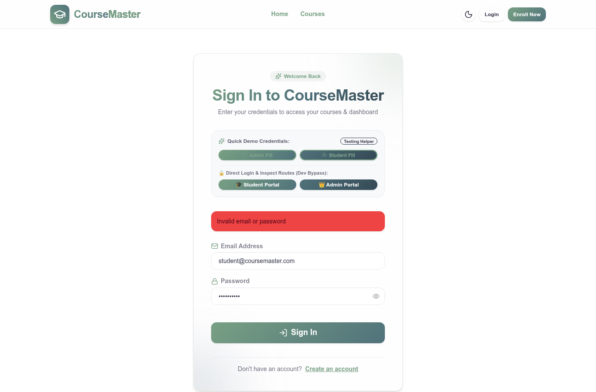
_Before fix_

**Fix & Verification Status:** Use bcrypt.compare() in auth.service.js login(). Files: src/services/auth.service.js. Status: **Fixed & Verified**.

### BUG-002: User stays logged out after a successful login

**Bug ID & Title:** BUG-002, User stays logged out after a successful login. Category: Authentication. Code: Frontend.

**Location & Steps to Reproduce:** Login page, Navbar, all protected routes. With BUG-001 fixed, log in as the student, then open /student.

**Expected vs. Actual Result:** Expected: Navbar shows the user avatar and /student opens the dashboard. Actual: saveToken() writes localStorage "user_token" but getToken() reads "token". Navbar still shows Login and /student redirects to /login.

**Severity & Evidence:** Critical, priority P1. Original frontend against fixed backend: localStorage keys after login = user_token, theme; /student redirected to /login.

_Before fix_

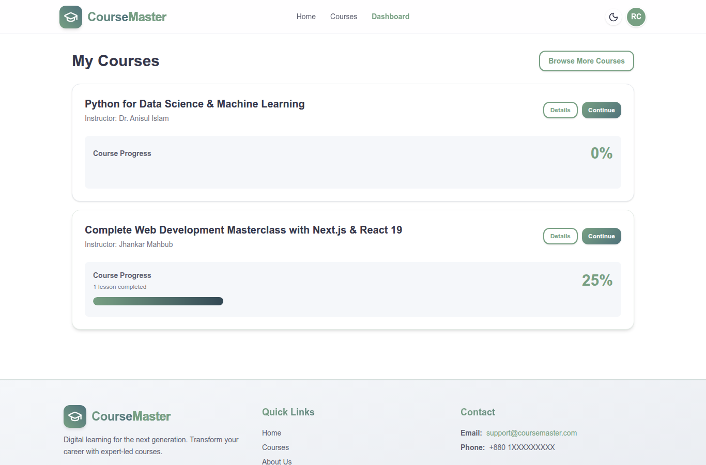
_After fix_

**Fix & Verification Status:** saveToken() stores the token under "token". Files: src/utils/auth.js. Status: **Fixed & Verified**.

### BUG-003: Authorization header is sent without the Bearer scheme

**Bug ID & Title:** BUG-003, Authorization header is sent without the Bearer scheme. Category: Authentication. Code: Frontend + Backend.

**Location & Steps to Reproduce:** Axios client (all authenticated API calls) and auth middleware. Log in and inspect any authenticated request in DevTools Network.

**Expected vs. Actual Result:** Expected: Header is "Authorization: Bearer <token>" and the server only accepts that format. Actual: The client sends the raw token, and the middleware was loosened to accept a header with or without Bearer.

**Severity & Evidence:** High, priority P2. src/services/api.js set config.headers.Authorization = token.

**Fix & Verification Status:** Client sends `Bearer ${token}`; middleware requires the Bearer prefix again. Files: FE src/services/api.js; BE src/middlewares/authMiddleware.js. Status: **Fixed & Verified**.

### BUG-004: Invalid or expired JWT is not rejected (500-style errors instead of 401)

**Bug ID & Title:** BUG-004, Invalid or expired JWT is not rejected (500-style errors instead of 401). Category: Authentication. Code: Backend.

**Location & Steps to Reproduce:** authMiddleware on every protected endpoint. GET /api/auth/me with header "Authorization: Bearer not.a.valid.jwt".

**Expected vs. Actual Result:** Expected: 401 Unauthorized, and the frontend sends the user to /login. Actual: Middleware calls next() when jwt.verify fails. /auth/me returns 404 and /enrollments/my returns 400, both with "Cannot read properties of undefined (reading 'id')". The 401 handler in the frontend never fires.

**Severity & Evidence:** High, priority P1. Before: status=404 {"message":"Cannot read properties of undefined (reading 'id')"}. After: 401 {"message":"Invalid or expired token"}.

**Fix & Verification Status:** Return 401 on verification failure; load the user from the database for each request. Files: src/middlewares/authMiddleware.js. Status: **Fixed & Verified**.

### BUG-005: Admin registration key is ignored

**Bug ID & Title:** BUG-005, Admin registration key is ignored. Category: Authorization. Code: Backend.

**Location & Steps to Reproduce:** Register page > Admin Registration (Optional) / POST /api/auth/register. Register with a valid admin key, then register again with adminKey "wrong".

**Expected vs. Actual Result:** Expected: Valid key creates an admin; an invalid key is rejected. Actual: Both create a student account and the wrong key is accepted silently. The key check was removed and the service reads a client-supplied role field instead. Zod strips that field today, so no role escalation was possible in testing, but nothing in the service prevents it.

**Severity & Evidence:** High, priority P2. Before: valid key -> role=student; invalid key -> 201 Created.

**Fix & Verification Status:** Restore the ADMIN_REGISTRATION_KEY check; never read role from the request. Files: src/services/auth.service.js. Status: **Fixed & Verified**.

### BUG-006: Client-side login bypass with hard-coded admin and student JWTs

**Bug ID & Title:** BUG-006, Client-side login bypass with hard-coded admin and student JWTs. Category: Security. Code: Frontend.

**Location & Steps to Reproduce:** Login page ("Direct Login & Inspect Routes (Dev Bypass)"), ProtectedRoute, Navbar. Open /login: the Dev Bypass section shows Student Portal and Admin Portal buttons. Or open /student?bypass=true without logging in.

**Expected vs. Actual Result:** Expected: No way into protected pages without a valid session; no tokens in the client bundle. Actual: The buttons write pre-signed JWTs (one with role admin) and dev_bypass=true to localStorage. ProtectedRoute then skips verification for dev_bypass or ?bypass=true, and treats any token as valid when /auth/me fails. The live site was not tested with these tokens.

**Severity & Evidence:** Critical, priority P1. Before: Dev Bypass section present on /login; protected page shell rendered for /student?bypass=true until the API returned 401.

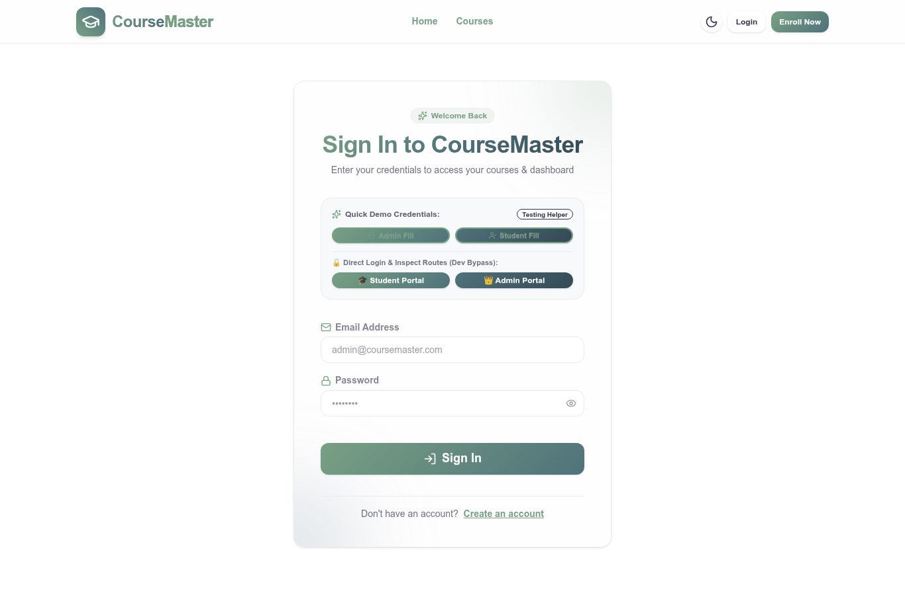
_Before fix_

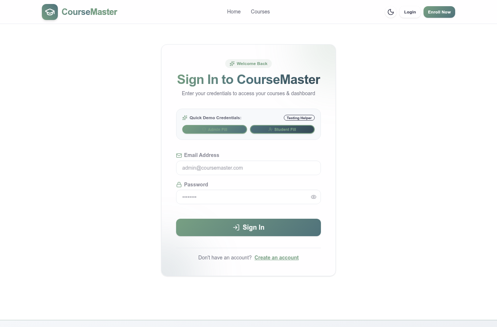
_After fix_

**Fix & Verification Status:** Removed the bypass buttons, the ?bypass and dev_bypass checks and the token fallback; a failed /auth/me now redirects to /login. Files: src/pages/Login/Login.jsx, src/routes/ProtectedRoute.jsx, src/components/shared/Navbar.jsx. Status: **Fixed & Verified**.

### BUG-007: Banning a user has no effect

**Bug ID & Title:** BUG-007, Banning a user has no effect. Category: Authorization. Code: Backend.

**Location & Steps to Reproduce:** Admin > Manage Users > Ban; login; every protected endpoint. Ban a student, then log in as that student, or keep using their existing session.

**Expected vs. Actual Result:** Expected: Banned user cannot log in and existing sessions stop working. Actual: Login succeeds and the old token keeps working for 30 days. Role changes and deletions also don't apply until the token expires.

**Severity & Evidence:** High, priority P2. Before: banned user's GET /auth/me returned 200. After: login 403 and existing token 403.

**Fix & Verification Status:** Login rejects banned users; the middleware loads the user on each request and rejects banned or deleted users, using the current role. Files: src/services/auth.service.js, src/middlewares/authMiddleware.js. Status: **Fixed & Verified**.

### BUG-008: Quiz answers are exposed by the public course API

**Bug ID & Title:** BUG-008, Quiz answers are exposed by the public course API. Category: Security. Code: Backend + Frontend.

**Location & Steps to Reproduce:** GET /api/courses and GET /api/courses/:id. Without logging in, open /api/courses/<id> and search the JSON for correctIndex.

**Expected vs. Actual Result:** Expected: Correct answers are only sent to a student after they submit the quiz. Actual: Every question's correctIndex is public, so students can read answers before attempting a quiz.

**Severity & Evidence:** Medium, priority P2. Before: correctIndex present in the public response. After: absent for guests and students; still present for admins, whose Edit Course page needs it.

**Fix & Verification Status:** Strip correctIndex for non-admins. Quiz submit and "my submissions" now return correctAnswers, and the player reads results from there. Files: BE src/services/course.service.js, quiz.service.js; FE src/pages/CoursePlayer/CoursePlayer.jsx. Status: **Fixed & Verified**.

### BUG-009: Students can open the player for courses they are not enrolled in

**Bug ID & Title:** BUG-009, Students can open the player for courses they are not enrolled in. Category: Authorization. Code: Frontend.

**Location & Steps to Reproduce:** /courses/:id/player. Log in as a student and open the player URL of a course you did not enroll in.

**Expected vs. Actual Result:** Expected: Message that enrollment is required, with a link to the course page. Actual: All modules, lessons and videos are playable without enrolling.

**Severity & Evidence:** High, priority P2. Before: video iframe rendered. After: warning shown and no iframe.

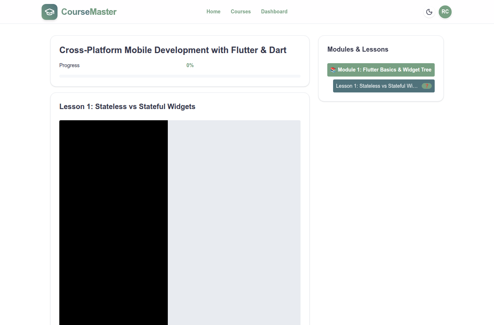
_Before fix_

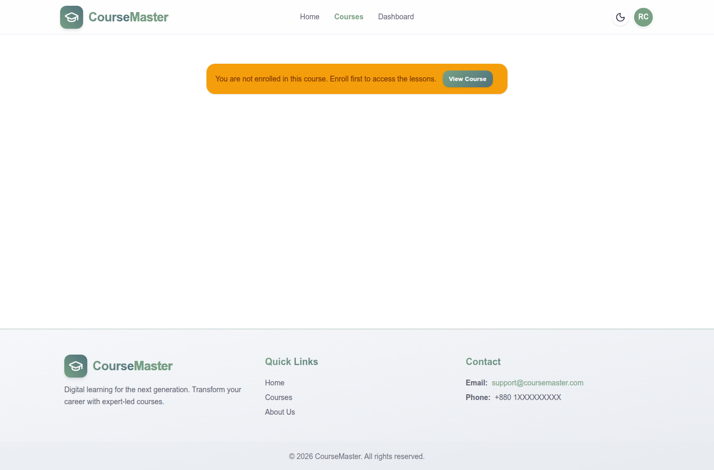
_After fix_

**Fix & Verification Status:** Player waits for the enrollment check and shows an enroll prompt when there is none. Files: src/pages/CoursePlayer/CoursePlayer.jsx. Status: **Fixed & Verified**.

### BUG-010: Any student can change another student's progress

**Bug ID & Title:** BUG-010, Any student can change another student's progress. Category: Authorization. Code: Backend.

**Location & Steps to Reproduce:** PATCH /api/enrollments/:enrollId/complete-lesson. As student A, call the endpoint with student B's enrollment id, or with a lesson id from another course.

**Expected vs. Actual Result:** Expected: 403 for someone else's enrollment; 400 for a lesson outside the course. Actual: No ownership check and no check that the lesson belongs to the course.

**Severity & Evidence:** High, priority P2. After: other student's enrollment -> 403; foreign lesson id -> 400.

**Fix & Verification Status:** Check enrollment.student against the caller and lessonId against the course syllabus. Files: src/services/enrollment.service.js, src/controllers/enrollment.controller.js. Status: **Fixed & Verified**.

### BUG-011: Enrolling in any course fails with "Already enrolled in this course"

**Bug ID & Title:** BUG-011, Enrolling in any course fails with "Already enrolled in this course". Category: Functional. Code: Backend.

**Location & Steps to Reproduce:** Course details > Enroll Now / POST /api/enrollments/:courseId. Register a new student, open a course and click Enroll Now.

**Expected vs. Actual Result:** Expected: Enrollment is created and the user goes to the dashboard. Actual: The duplicate check is inverted: it throws when the student is NOT enrolled.

**Severity & Evidence:** Critical, priority P1. Before: new student -> 400 "Already enrolled in this course". After: 201 Created, and a second attempt gets the duplicate message.

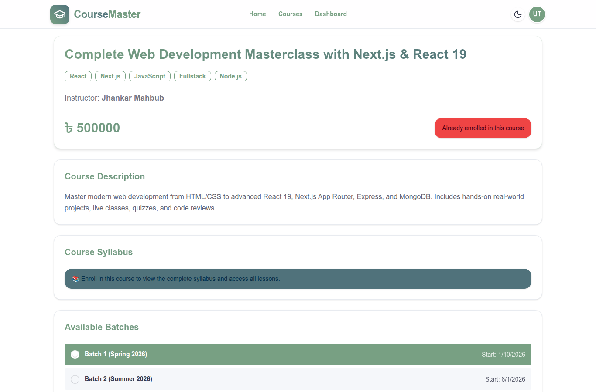
_Before fix_

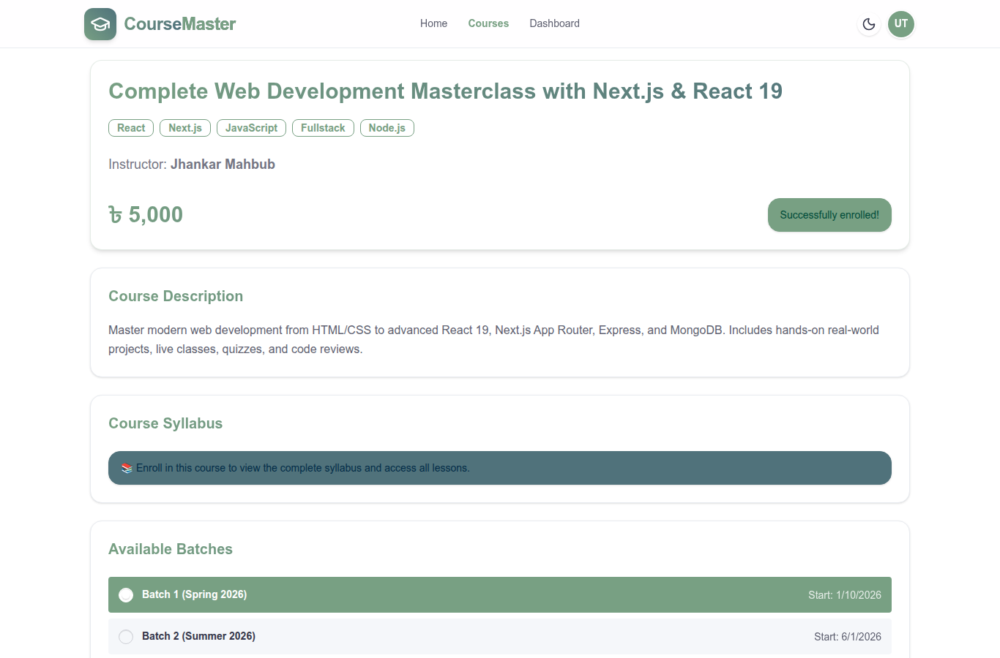
_After fix_

**Fix & Verification Status:** Throw only when an enrollment already exists. Files: src/services/enrollment.service.js. Status: **Fixed & Verified**.

### BUG-012: Lesson completion is saved without await

**Bug ID & Title:** BUG-012, Lesson completion is saved without await. Category: Backend. Code: Backend.

**Location & Steps to Reproduce:** PATCH /api/enrollments/:id/complete-lesson. Mark a lesson complete and immediately reload the dashboard.

**Expected vs. Actual Result:** Expected: The response is sent after the progress is stored, and save errors reach the client. Actual: enrollment.save() is not awaited. A failed save is an unhandled promise rejection, which stops the Node process by default, and the client already got a 200. Found by code review: no failing save occurred during testing.

**Severity & Evidence:** Medium, priority P2. Code: `enrollment.save(); return enrollment;` (comment marks it Code-9).

**Fix & Verification Status:** await enrollment.save(); percent is capped at 100 and only counts lessons that still exist. Files: src/services/enrollment.service.js. Status: **Fixed & Verified**.

### BUG-013: Quiz score is ten times too low

**Bug ID & Title:** BUG-013, Quiz score is ten times too low. Category: Functional. Code: Backend.

**Location & Steps to Reproduce:** Course player > Quiz > Submit / POST /api/quizzes/submit. Answer every question correctly and submit.

**Expected vs. Actual Result:** Expected: 100%. Actual: 10%: percent is calculated as score / total * 10.

**Severity & Evidence:** High, priority P2. Before: all 1 answers correct -> score=1/1 percent=10%. After: 2/2 -> 100%.

**Fix & Verification Status:** Multiply by 100; also validate that answers is an array with one entry per question. Files: src/services/quiz.service.js. Status: **Fixed & Verified**.

### BUG-014: Student dashboard is a blank page

**Bug ID & Title:** BUG-014, Student dashboard is a blank page. Category: Data Handling. Code: Frontend.

**Location & Steps to Reproduce:** /student (Dashboard). Log in as a student and open Dashboard.

**Expected vs. Actual Result:** Expected: List of enrolled courses with progress. Actual: Blank page. The reducer stores action.payload.data (undefined) instead of the array, then enrollments.length throws.

**Severity & Evidence:** Critical, priority P1. Console: "Cannot read properties of undefined (reading 'length')".

_Before fix_

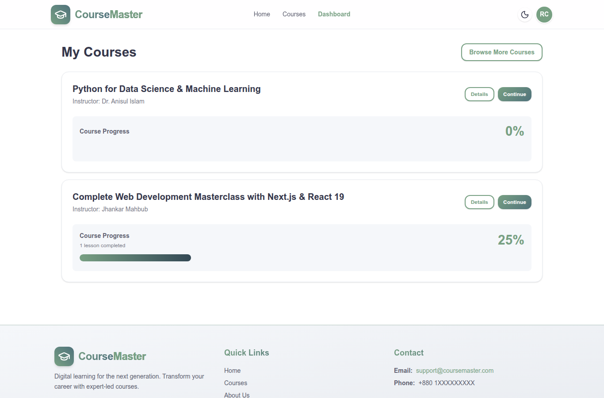
_After fix_

**Fix & Verification Status:** Store the payload array (empty array fallback). Files: src/store/slices/enrollmentSlice.js. Status: **Fixed & Verified**.

### BUG-015: Dashboard progress shows NaN%

**Bug ID & Title:** BUG-015, Dashboard progress shows NaN%. Category: Data Handling. Code: Frontend.

**Location & Steps to Reproduce:** /student > course card > Course Progress. With BUG-014 fixed, open the dashboard without expanding a course.

**Expected vs. Actual Result:** Expected: The stored progress percent (for example 25%). Actual: The number is recalculated from course stats that load only after Details is clicked, so it shows NaN%, while the progress bar uses the stored value.

**Severity & Evidence:** Medium, priority P2. Masked by BUG-014 on the original build; confirmed in code (division by an undefined lesson total).

**Fix & Verification Status:** Show enrollment.progress.percent, the value the backend maintains. Files: src/pages/student/StudentDashboard.jsx. Status: **Fixed & Verified**.

### BUG-016: Course price is shown 100 times higher on the details page

**Bug ID & Title:** BUG-016, Course price is shown 100 times higher on the details page. Category: Data Handling. Code: Frontend.

**Location & Steps to Reproduce:** /courses/:id. Open any course with price 5000.

**Expected vs. Actual Result:** Expected: ৳ 5,000 (same as the course card). Actual: ৳ 500000 because the template multiplies price by 100.

**Severity & Evidence:** High, priority P2. API price=5000; page showed "৳ 500000".

_Before fix_

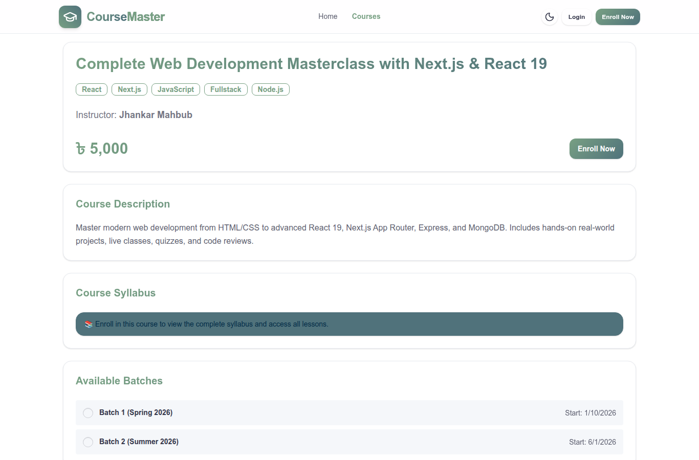
_After fix_

**Fix & Verification Status:** Render course.price with toLocaleString(). Files: src/pages/CousrseDetails/CourseDetails.jsx. Status: **Fixed & Verified**.

### BUG-017: Selecting a batch breaks enrollment, and the first batch shows no confirmation

**Bug ID & Title:** BUG-017, Selecting a batch breaks enrollment, and the first batch shows no confirmation. Category: Functional. Code: Frontend.

**Location & Steps to Reproduce:** /courses/:id > Available Batches. Select the first batch, then click Enroll.

**Expected vs. Actual Result:** Expected: "Batch selected" confirmation, and the enrollment is saved with that batch. Actual: The array index ("0") is sent as batchId, which the ObjectId field cannot store. `{selectedBatchId && ...}` hides the confirmation because 0 is falsy.

**Severity & Evidence:** Medium, priority P2. Before: confirmation not visible after clicking the first batch. After: visible.

**Fix & Verification Status:** Use batch._id as the identifier and compare with null; the backend ignores a batchId that doesn't belong to the course. Files: FE src/pages/CousrseDetails/CourseDetails.jsx; BE src/services/enrollment.service.js. Status: **Fixed & Verified**.

### BUG-018: Quiz lets you answer only one question at a time

**Bug ID & Title:** BUG-018, Quiz lets you answer only one question at a time. Category: Functional. Code: Frontend.

**Location & Steps to Reproduce:** Course player > Quiz. Pick an answer for question 1, then for question 2.

**Expected vs. Actual Result:** Expected: Both answers stay selected. Actual: All radio buttons share name="quiz-option", so selecting an answer clears the others.

**Severity & Evidence:** High, priority P2. Before: 1 checked radio after answering two questions. After: 2.

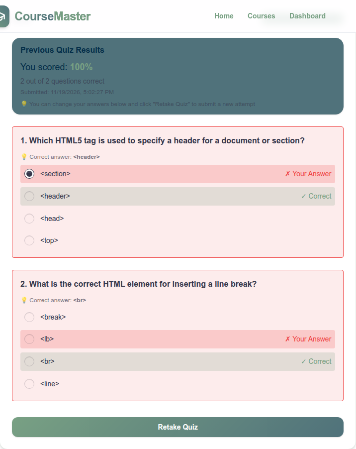
_Before fix_

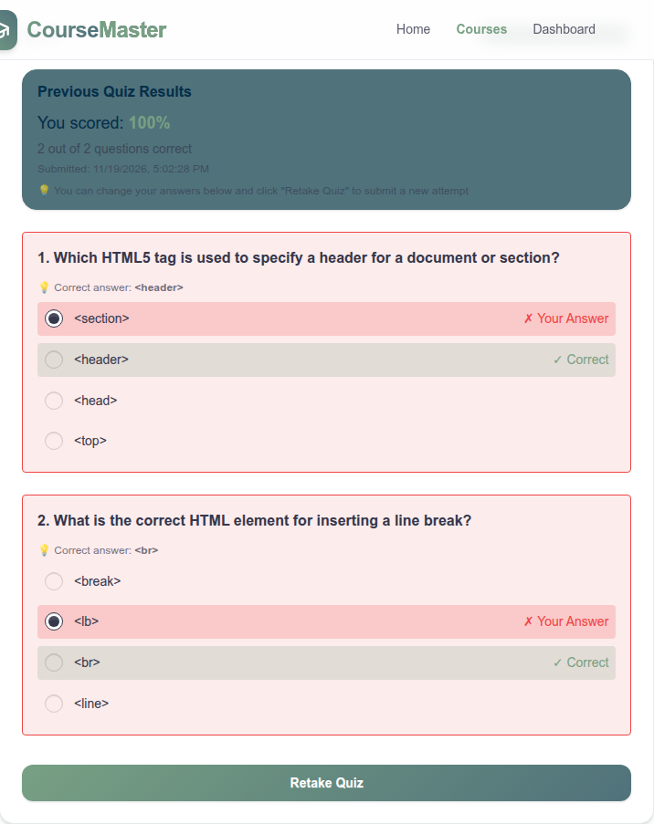
_After fix_

**Fix & Verification Status:** Unique name per question (question-<lessonId>-<index>); the quiz and assignment components also get a key per lesson so their state resets. Files: src/pages/CoursePlayer/CoursePlayer.jsx. Status: **Fixed & Verified**.

### BUG-019: "Mark as Complete" never switches to "Completed"

**Bug ID & Title:** BUG-019, "Mark as Complete" never switches to "Completed". Category: Functional. Code: Frontend.

**Location & Steps to Reproduce:** Course player > lesson video card. Mark a lesson complete, or open a lesson that is already complete.

**Expected vs. Actual Result:** Expected: Button shows "Completed ✓" and is disabled. Actual: completedLessons holds ids but the code calls includes(lesson) with the lesson object, so the button stays active.

**Severity & Evidence:** Medium, priority P3. After: completed lesson shows a disabled "Completed ✓" button.

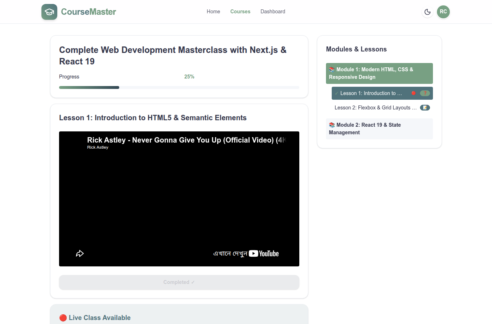
_After fix_

**Fix & Verification Status:** Compare with lesson._id. Files: src/pages/CoursePlayer/CoursePlayer.jsx. Status: **Fixed & Verified**.

### BUG-020: Course search fails on special characters

**Bug ID & Title:** BUG-020, Course search fails on special characters. Category: Functional. Code: Backend + Frontend.

**Location & Steps to Reproduce:** /courses > Search. Search for "(React".

**Expected vs. Actual Result:** Expected: Search runs and shows matches or "No courses found". Actual: Input is used as a raw regular expression; the API returns 400 "Regular expression is invalid" and the page shows "Failed to load courses".

**Severity & Evidence:** Medium, priority P3. Before: alert "Failed to load courses". After: empty result list, no error.

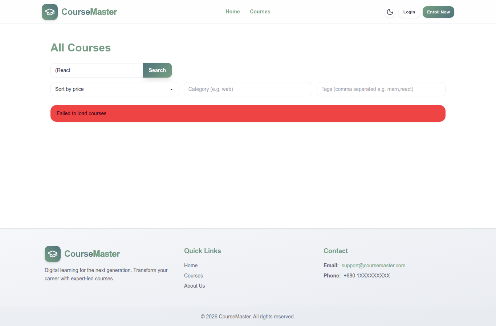
_Before fix_

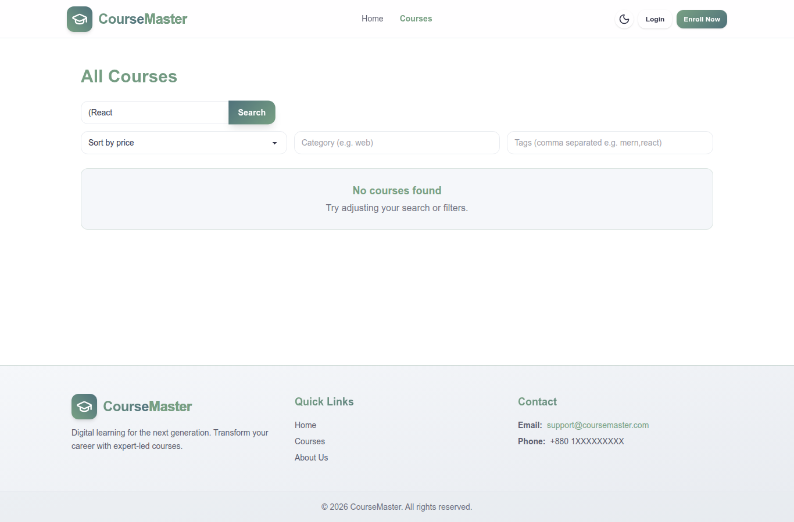
_After fix_

**Fix & Verification Status:** Escape regex characters in search, category and tags. Files: src/services/course.service.js. Status: **Fixed & Verified**.

### BUG-021: Category and tag filters only match exact, case-sensitive values

**Bug ID & Title:** BUG-021, Category and tag filters only match exact, case-sensitive values. Category: Functional. Code: Backend.

**Location & Steps to Reproduce:** /courses > Category / Tags filters. Type "web" in Category (the placeholder's own example).

**Expected vs. Actual Result:** Expected: Shows the "Web Development" course. Actual: "No courses found"; only the exact text "Web Development" works. Tags "react" also misses "React".

**Severity & Evidence:** Medium, priority P3. Before: 0 cards for "web". After: 1 card.

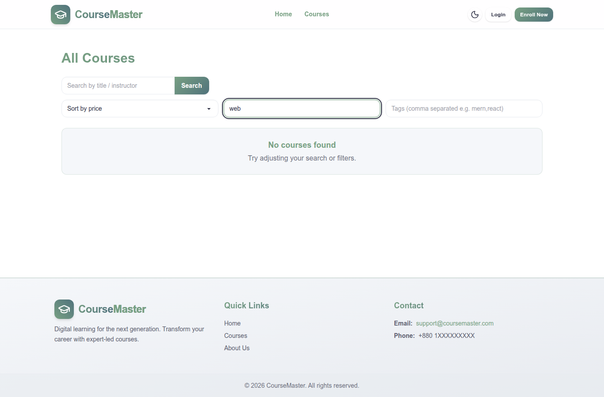
_Before fix_

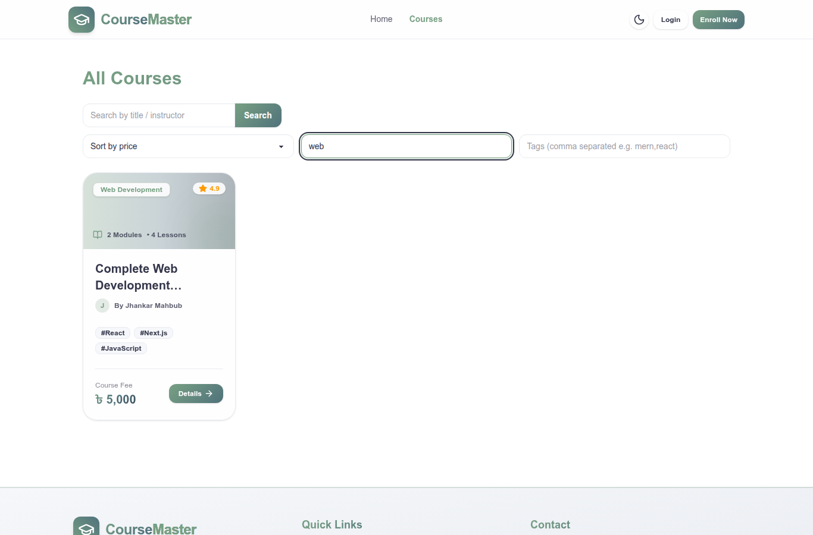
_After fix_

**Fix & Verification Status:** Category: case-insensitive partial match. Tags: case-insensitive exact match. Files: src/services/course.service.js. Status: **Fixed & Verified**.

### BUG-022: Signed-in user is never loaded into app state on page load

**Bug ID & Title:** BUG-022, Signed-in user is never loaded into app state on page load. Category: Data Handling. Code: Frontend.

**Location & Steps to Reproduce:** MainLayout / Courses page / Home. Log in as admin, reload, open /courses.

**Expected vs. Actual Result:** Expected: Admin sees the "Manage Courses" button under the course grid. Actual: MainLayout only loads the user when isAuthenticated is false, but it starts true when a token exists, so state.auth.user stays null and admin-only UI is hidden.

**Severity & Evidence:** Medium, priority P3. Before: Manage Courses buttons = 0. After: 1.

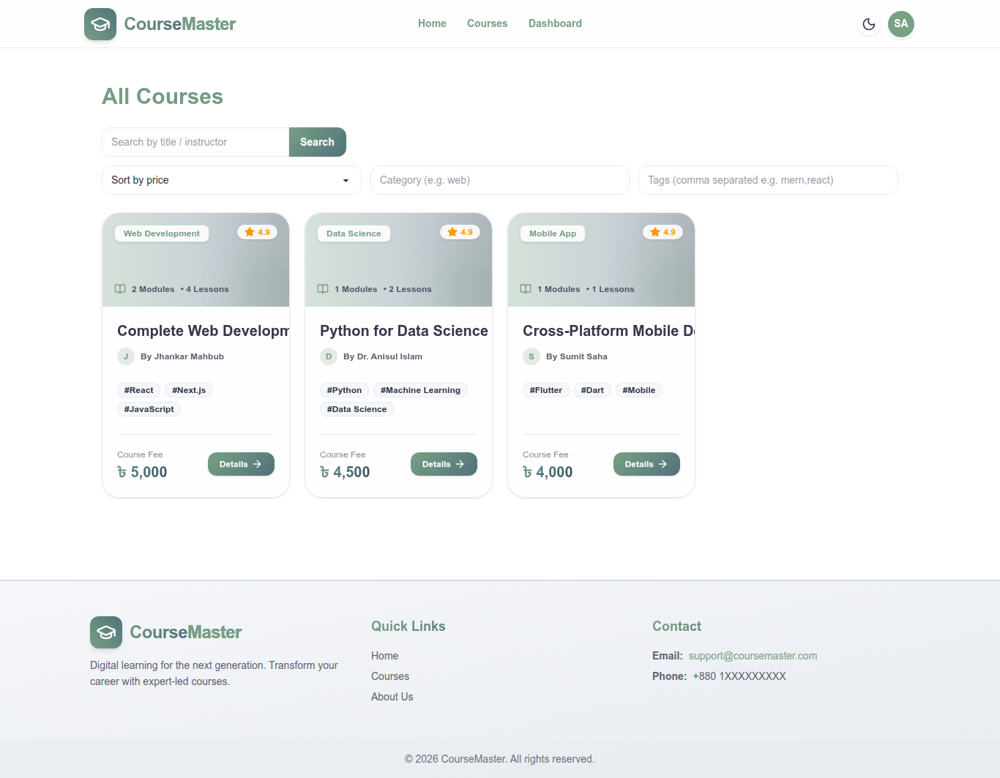
_Before fix_

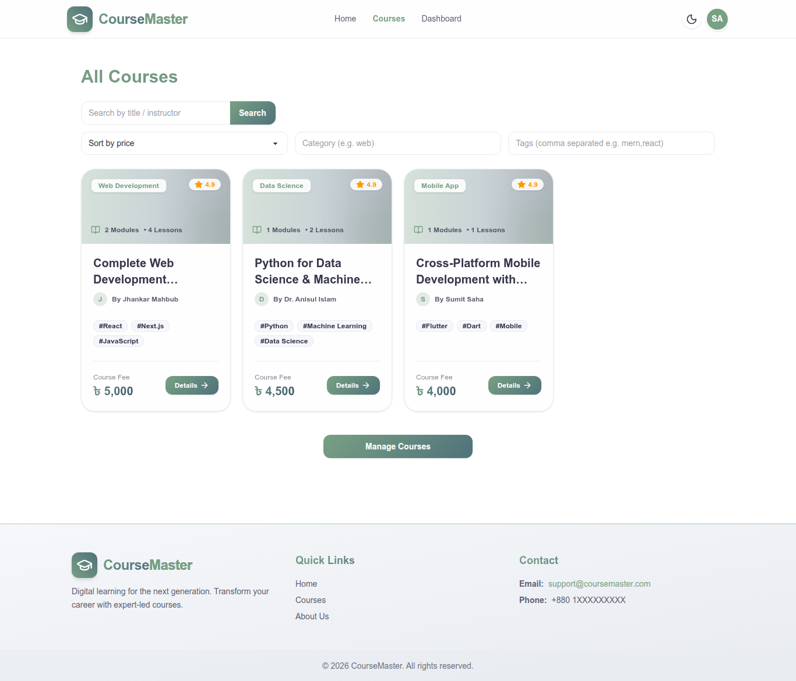
_After fix_

**Fix & Verification Status:** Load the user when there is a token and no user. Navbar reads the user from Redux instead of making its own request. Files: src/layouts/MainLayout.jsx, src/components/shared/Navbar.jsx, src/pages/CousrseDetails/CourseDetails.jsx. Status: **Fixed & Verified**.

### BUG-023: Admin overview "Top Courses by Enrollments" chart never appears

**Bug ID & Title:** BUG-023, Admin overview "Top Courses by Enrollments" chart never appears. Category: Data Handling. Code: Frontend.

**Location & Steps to Reproduce:** /admin (Overview). Log in as admin and open the dashboard.

**Expected vs. Actual Result:** Expected: Bar chart of the top courses. Actual: The page reads analytics.topCourses / courseTitle / count, but the API returns enrollmentsByCourse / courseName / enrollments, so the data is empty and the section is hidden.

**Severity & Evidence:** Medium, priority P3. Before: section absent. After: chart rendered with 2 bars.

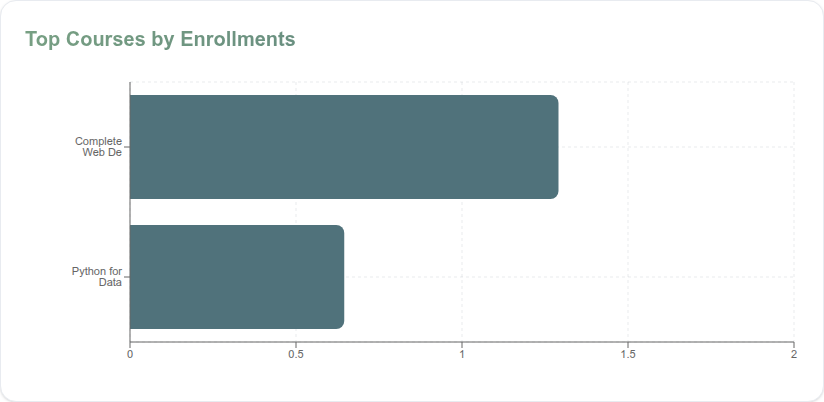
_After fix_

**Fix & Verification Status:** Map the fields the API actually returns. Files: src/pages/admin/pages/AdminOverview.jsx. Status: **Fixed & Verified**.

### BUG-024: Deleting a course or user leaves orphaned enrollments and submissions

**Bug ID & Title:** BUG-024, Deleting a course or user leaves orphaned enrollments and submissions. Category: Backend. Code: Backend.

**Location & Steps to Reproduce:** Admin > Manage Courses > Delete; Admin > Manage Users > Delete. Delete a course that has enrolled students, then open the student's dashboard and Admin > Enrollments.

**Expected vs. Actual Result:** Expected: Related enrollments and submissions are removed. Actual: Enrollments stay with course=null: the student sees an empty card linking to /courses/undefined/player, and admin lists show blank rows.

**Severity & Evidence:** Medium, priority P3. Before: student enrollments after delete = [course=null (orphan), ...]; admin rows with course=null: 1.

**Fix & Verification Status:** Delete enrollments, quiz and assignment submissions with the course or user; my-enrollments also filters out missing courses. Files: src/services/admin.service.js, user.service.js, enrollment.service.js. Status: **Fixed & Verified**.

### BUG-025: Admin assignments ?courseId filter is ignored

**Bug ID & Title:** BUG-025, Admin assignments ?courseId filter is ignored. Category: Backend. Code: Backend.

**Location & Steps to Reproduce:** GET /api/admin/assignments?courseId=.... Request the list with a courseId that has no submissions.

**Expected vs. Actual Result:** Expected: Only that course's submissions (empty list). Actual: The controller doesn't pass the query, and the service filters on courseId, a field that doesn't exist (the schema uses course).

**Severity & Evidence:** Low, priority P3. After: all=1, filtered=0.

**Fix & Verification Status:** Pass req.query and filter on course (status filter added too). Files: src/controllers/admin.controller.js, src/services/admin.service.js. Status: **Fixed & Verified**.

### BUG-026: Validation errors give no details

**Bug ID & Title:** BUG-026, Validation errors give no details. Category: Data Validation. Code: Backend + Frontend.

**Location & Steps to Reproduce:** Register and Login forms. Register with a 5-character password.

**Expected vs. Actual Result:** Expected: "Password must be at least 6 characters" (and the form should block it before sending). Actual: Only "Validation error": the middleware reads err.errors, which Zod v4 doesn't have. The form has no length limits.

**Severity & Evidence:** Medium, priority P3. Before: {"message":"Validation error"}. After: first issue as message plus a field list.

**Fix & Verification Status:** Use safeParse and result.error.issues; minLength on name and password inputs; trim and lowercase email. Files: BE src/middlewares/validate.js, src/validators/auth.validation.js; FE src/pages/Register/Register.jsx. Status: **Fixed & Verified**.

### BUG-027: No server validation for grades, review status or course price

**Bug ID & Title:** BUG-027, No server validation for grades, review status or course price. Category: Data Validation. Code: Backend.

**Location & Steps to Reproduce:** PATCH /api/admin/assignments/:id/review; POST/PATCH /api/admin/courses. Review with grade 500 and status "banana"; create or update a course with price -100.

**Expected vs. Actual Result:** Expected: 400 with a clear message. Actual: Values are saved as sent (updates skip schema validators).

**Severity & Evidence:** Medium, priority P3. After: all three requests return 400.

**Fix & Verification Status:** Grade 0-100 and status enum checks; price min 0; runValidators on updates. Files: src/services/admin.service.js, src/models/Course.js. Status: **Fixed & Verified**.

### BUG-028: Invalid course id shows a raw database error

**Bug ID & Title:** BUG-028, Invalid course id shows a raw database error. Category: API Integration. Code: Backend.

**Location & Steps to Reproduce:** /courses/<bad id>. Open /courses/not-an-id.

**Expected vs. Actual Result:** Expected: "Course not found". Actual: "Cast to ObjectId failed for value \"not-an-id\"...".

**Severity & Evidence:** Low, priority P4. After: 404 "Course not found".

**Fix & Verification Status:** Validate the id with mongoose.isValidObjectId before querying. Files: src/services/course.service.js. Status: **Fixed & Verified**.

### BUG-029: Lesson video is a narrow 300×700 strip

**Bug ID & Title:** BUG-029, Lesson video is a narrow 300×700 strip. Category: UI/UX. Code: Frontend.

**Location & Steps to Reproduce:** Course player. Open any enrolled course in the player.

**Expected vs. Actual Result:** Expected: Responsive 16:9 video filling the card. Actual: Inline style height:700px; width:300px replaced the aspect-video layout.

**Severity & Evidence:** High, priority P2. Before: iframe 300×700. After: 667×375 at 1366px width.

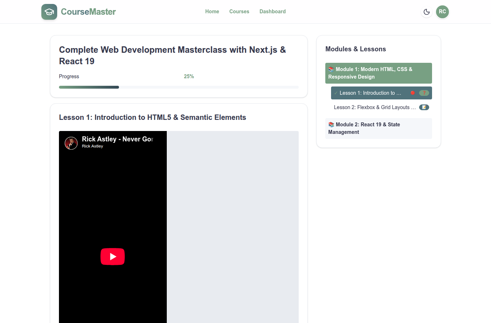
_Before fix_

_After fix_

**Fix & Verification Status:** Restore the aspect-video wrapper with a full-size iframe. Files: src/pages/CoursePlayer/CoursePlayer.jsx. Status: **Fixed & Verified**.

### BUG-030: Mobile menu is cut off, so Logout and Dashboard can't be reached

**Bug ID & Title:** BUG-030, Mobile menu is cut off, so Logout and Dashboard can't be reached. Category: UI/UX. Code: Frontend.

**Location & Steps to Reproduce:** Navbar on screens under 768px. Open the site at 390px width while logged in and tap the menu.

**Expected vs. Actual Result:** Expected: Full menu with links, profile and Logout. Actual: The menu has max-h-32 overflow-hidden and shows only the first three items.

**Severity & Evidence:** Medium, priority P3. Before: menu clipped. After: full menu.

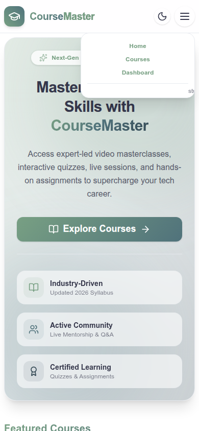
_Before fix_

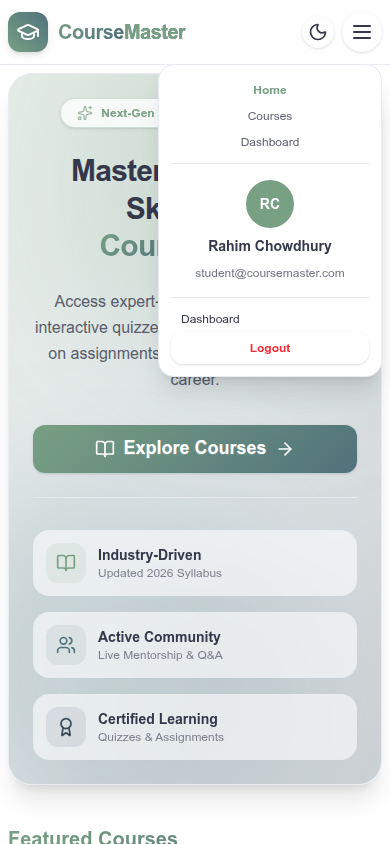
_After fix_

**Fix & Verification Status:** Remove the height limit. Files: src/components/shared/Navbar.jsx. Status: **Fixed & Verified**.

### BUG-031: Every navbar link is highlighted as active

**Bug ID & Title:** BUG-031, Every navbar link is highlighted as active. Category: UI/UX. Code: Frontend.

**Location & Steps to Reproduce:** Navbar (all pages). Open any page.

**Expected vs. Actual Result:** Expected: Only the current page's link is highlighted. Actual: The active check also tests pathname.startsWith("/"), which is always true.

**Severity & Evidence:** Low, priority P4. Before: 2 links (Home and Courses) highlighted on /courses/:id. After: 1.

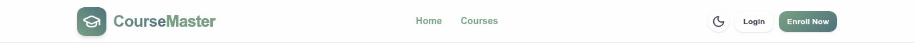
_Before fix_

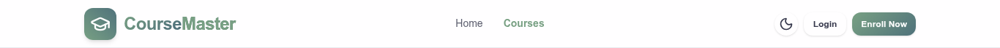
_After fix_

**Fix & Verification Status:** Use NavLink's isActive only. Files: src/components/shared/Navbar.jsx. Status: **Fixed & Verified**.

### BUG-032: Long course titles overflow the course card

**Bug ID & Title:** BUG-032, Long course titles overflow the course card. Category: UI/UX. Code: Frontend.

**Location & Steps to Reproduce:** Home / Courses grid. Create a course with a long title and open /courses.

**Expected vs. Actual Result:** Expected: Title wraps inside the card. Actual: whitespace-nowrap overflow-visible lets the title run past the card edge. The card also nests a div inside a p, which React warns about.

**Severity & Evidence:** Low, priority P3. Before: title overflows. After: contained, two lines max with full title on hover.

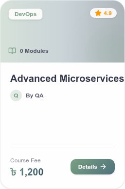
_Before fix_

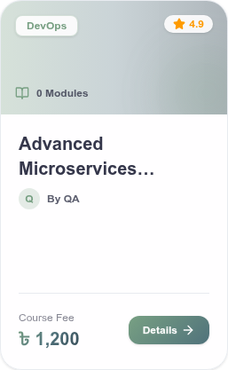
_After fix_

**Fix & Verification Status:** line-clamp-2 with break-words; the p becomes a div. Files: src/components/CourseCard/CourseCard.jsx. Status: **Fixed & Verified**.

### BUG-033: User emails are unreadable in dark mode

**Bug ID & Title:** BUG-033, User emails are unreadable in dark mode. Category: UI/UX. Code: Frontend.

**Location & Steps to Reproduce:** Admin > Manage Users. Switch to dark theme and open Manage Users.

**Expected vs. Actual Result:** Expected: Email text readable on the dark background. Actual: The email cell has a hard-coded color #1e293b (dark slate) on a dark background.

**Severity & Evidence:** Low, priority P3. Before: email color rgb(30, 41, 59). After: theme text color rgb(245, 247, 250).

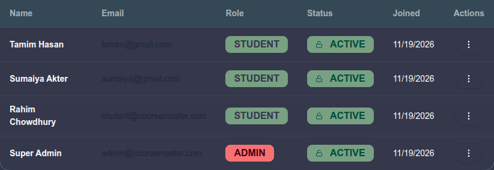
_Before fix_

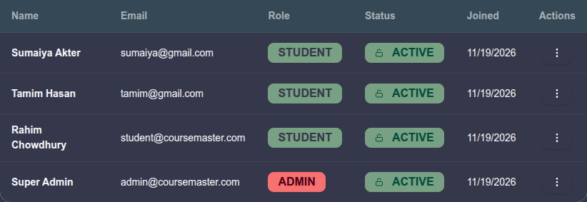
_After fix_

**Fix & Verification Status:** Remove the inline color so the theme color applies. Files: src/pages/admin/pages/ManageUsers.jsx. Status: **Fixed & Verified**.

### BUG-034: Profile link leads to an unstyled 404

**Bug ID & Title:** BUG-034, Profile link leads to an unstyled 404. Category: UI/UX. Code: Frontend.

**Location & Steps to Reproduce:** Navbar avatar menu > Profile. Click Profile.

**Expected vs. Actual Result:** Expected: A profile page, or no link if none exists. Actual: There is no /profile route; the 404 page is plain red "404 Not Found" text with no way back.

**Severity & Evidence:** Low, priority P4. Before and after screenshots of /profile.

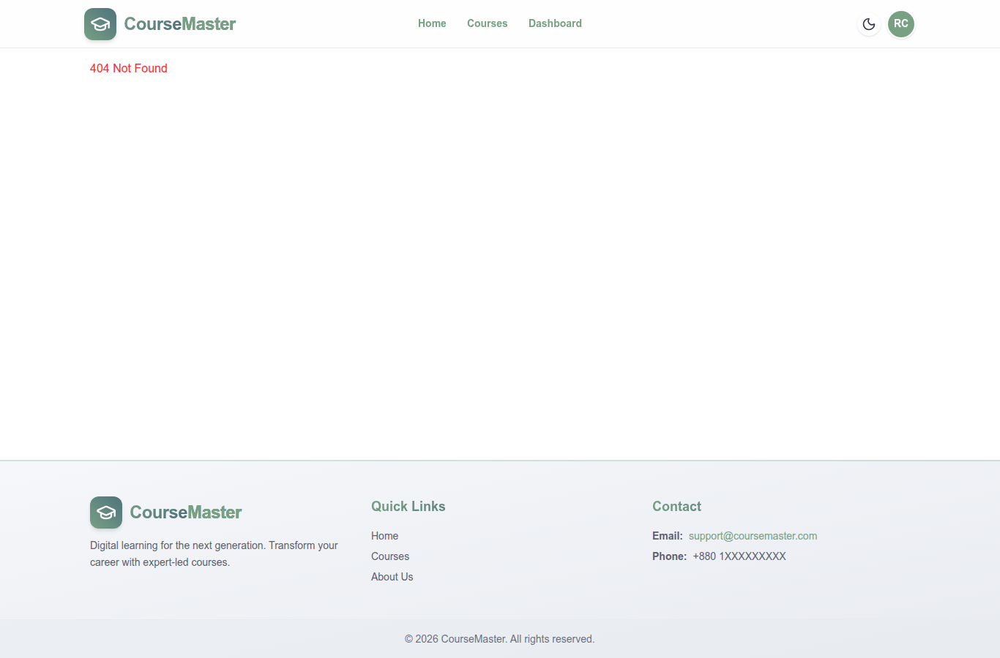
_Before fix_

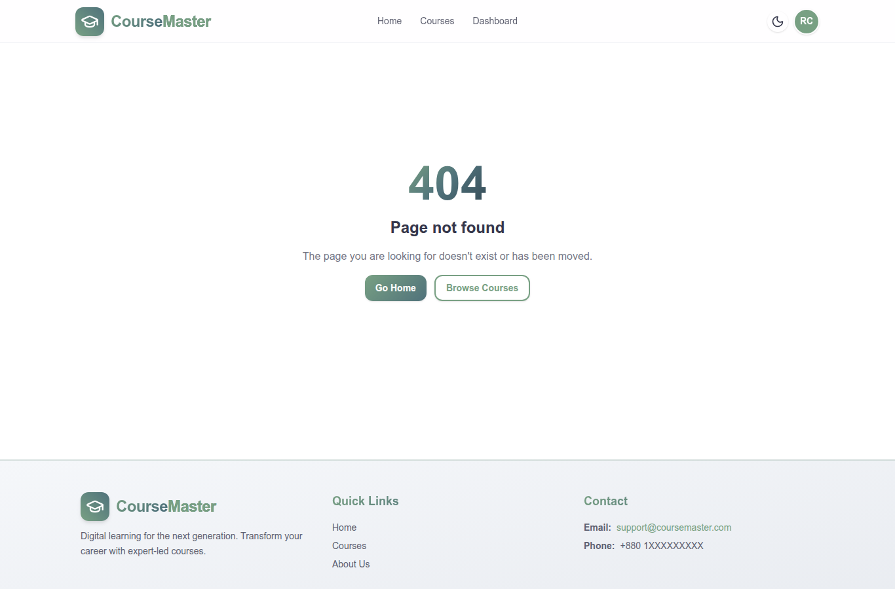
_After fix_

**Fix & Verification Status:** Removed the Profile links; 404 page now has a heading and links to Home and Courses. Files: src/components/shared/Navbar.jsx, src/pages/NotFound/NotFound.jsx. Status: **Fixed & Verified**.

### BUG-035: Course filters send a request on every keystroke and can show stale results

**Bug ID & Title:** BUG-035, Course filters send a request on every keystroke and can show stale results. Category: Performance. Code: Frontend.

**Location & Steps to Reproduce:** /courses filters and search. Type "web" in Category; or go to page 2 and run a search.

**Expected vs. Actual Result:** Expected: One request after typing stops; results always match the latest query. Actual: One request per character. Search fetched with the old page number first and then again, and whichever response arrived last won.

**Severity & Evidence:** Low, priority P3. Before: 3 requests for "web". After: 1.

**Fix & Verification Status:** 400 ms debounce, a single fetch effect, applied-search state, and responses from outdated requests are ignored. Files: src/components/CourseCard/CoursesSection.jsx. Status: **Fixed & Verified**.

### BUG-036: Environment examples are wrong

**Bug ID & Title:** BUG-036, Environment examples are wrong. Category: Setup. Code: Backend + Frontend.

**Location & Steps to Reproduce:** .env.example in both repositories. Follow the README: copy .env.example to .env and run the backend.

**Expected vs. Actual Result:** Expected: Example lists MONGO_URI, JWT_SECRET, ADMIN_REGISTRATION_KEY and the other variables the server reads. Actual: The backend file contains the frontend's VITE_API_BASE_URL, so the server stops with "MONGO_URI missing". The frontend example points local development at the production API.

**Severity & Evidence:** Medium, priority P3. Backend .env.example content before the fix.

**Fix & Verification Status:** Backend example lists all server variables; frontend example uses http://localhost:5000/api. Files: BE .env.example; FE .env.example. Status: **Fixed & Verified**.

### BUG-037: Server adds a CORS header that allows only GET and POST

**Bug ID & Title:** BUG-037, Server adds a CORS header that allows only GET and POST. Category: API Integration. Code: Backend.

**Location & Steps to Reproduce:** app.js (marked Code-10). Send a PATCH request and inspect the response headers.

**Expected vs. Actual Result:** Expected: CORS config lists every method the API uses. Actual: A middleware after cors() sets Access-Control-Allow-Methods: GET, POST on responses. Browsers were not blocked in testing because cors() answers the preflight before this middleware runs, but the header is wrong.

**Severity & Evidence:** Low, priority P4. Preflight already returned GET,HEAD,PUT,PATCH,POST,DELETE, so impact was limited.

**Fix & Verification Status:** Removed the override; cors() lists the methods explicitly. Files: app.js. Status: **Fixed & Verified**.
